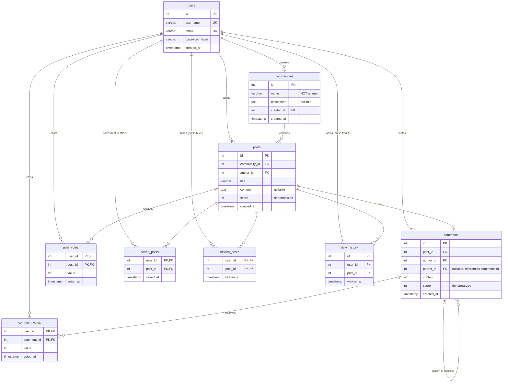

# Database Schema

Source of truth: the live PostgreSQL database (`pg_dump` of `reddit_clone`, Oct 2026), not the SQLAlchemy models. If the two ever disagree, the migrations have drifted. Regenerate this file when the schema changes.

## Entity–relationship diagram

All columns are `NOT NULL` unless marked nullable. Timestamps are `timestamp without time zone`, so the app must store everything in UTC.

## Indexes

| Index | Columns | Serves |
|---|---|---|
| `ix_posts_community_created` | `posts(community_id, created_at)` | Community feed, newest first |
| `ix_posts_community_score` | `posts(community_id, score)` | Community feed, top |
| `ix_posts_author_created` | `posts(author_id, created_at)` | A user's posts |
| `ix_comments_post` | `comments(post_id)` | Load all comments of a post, then build the tree in Python |
| `ix_comments_author_created` | `comments(author_id, created_at)` | A user's comments |
| PK `post_votes(user_id, post_id)` | | One vote per user per post; "did I vote on this?" |
| PK `comment_votes(user_id, comment_id)` | | One vote per user per comment |
| UNIQUE `users(username)`, `users(email)` | | Login lookup, duplicate prevention |

## Design decisions

- **Comments use an adjacency list.** Each comment has `parent_id`, and top-level comments have `parent_id = NULL`. The tree is loaded with one query per post (`ix_comments_post`) and assembled in Python. A recursive CTE is the Week 6 alternative.
- **Scores are denormalized.** `posts.score` and `comments.score` are caches; `post_votes` and `comment_votes` are the source of truth. The cache must be updated in the same transaction as the vote row.
- **Votes are separate tables per target** rather than one polymorphic `votes` table. This keeps real foreign keys on both sides.
- **The composite primary key on the vote tables** is what makes double-voting impossible at the database level.
- **No community membership table.** The home feed is global. Joining communities is outside the MVP.
- **`saved_posts`, `hidden_posts`, `view_history`** exist in the schema but have no routes. They're out of MVP scope.
